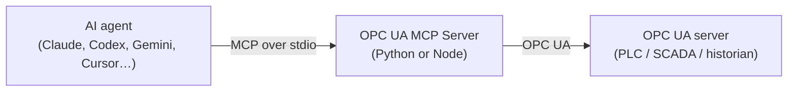

<div align="center">

# 🏭 OPC UA MCP Server

**Let Claude, Codex, Gemini and any other MCP agent read sensors, browse the plant and — only when you allow it — control equipment on any OPC UA server.**

[](https://www.npmjs.com/package/opcua-mcp-server)
[](https://pypi.org/project/opcua-mcp-server/)
[](https://www.npmjs.com/package/opcua-mcp-server)
[](https://github.com/IndustriAgents/OPCUA-MCP/actions/workflows/ci.yml)
[](https://modelcontextprotocol.io)
[](LICENSE)

[Quick start](#quick-start) · [Connect your agent](#connect-your-agent) · [Tools](#tools) · [Production](#going-to-production) · [Docs](#documentation)

</div>


This project is a bridge between an AI agent and an OPC UA server. OPC UA is the
protocol used to expose industrial equipment and its data; MCP (Model Context
Protocol) lets an agent call tools to work with that data. The bridge runs on
your computer and connects to an existing OPC UA server, or to a local simulator
for a first test.

Your MCP client starts the bridge as a local **stdio** process: it exchanges MCP
messages over standard input and output. One process connects one client context
to one OPC UA endpoint. Use a separate process for each endpoint. Remote MCP and
shared multi-client operation are gated by the
[identity and isolation RFC](docs/rfc/0001-remote-identity-isolation.md).

## Features

- 🔌 **Any OPC UA server** — PLC, SCADA gateway or historian. Nothing to install on the plant side.
- 🧰 **The whole operator toolkit** — read, browse, history and aggregates, subscriptions, events and alarms, writes and method calls.
- 🛡️ **Read-only by default** — writes and method calls need an explicit control profile and an authenticated server (pinned certificate or CA trust store). The `operator` profile also requires allowlisted targets, and every control call is audited.
- 🐍 **Python or Node** — two first-class runtimes with the same tool contract. [Use whichever you have](docs/install.md#which-runtime-am-i-installing), accounting for the [documented runtime differences](docs/compatibility.md#runtime-differences).
- 📦 **One-file Claude Desktop install** — a `.mcpb` bundle with nothing else to set up.



## Quick start

Follow these steps in order: choose an installation, start or identify an OPC UA
server, configure your MCP client, then check the connection. You need an MCP
client such as one of the agents listed [below](#connect-your-agent).

### 1. Choose an installation

Choose **one** runtime; you do not need both. The package routes fetch the server
on demand, so you do not need to clone this repository to use an existing OPC UA
server.

| Route | Prerequisites | Command your MCP client launches |
|---|---|---|
| Node package | Node.js **22.13+**, including npm and npx | `npx -y opcua-mcp-server` |
| Python package | Python **3.10+** and [uv](https://docs.astral.sh/uv/getting-started/installation/) (which supplies uvx) | `uvx opcua-mcp-server` |
| Claude Desktop bundle | Claude Desktop; no separate Node or Python installation | Install the `.mcpb` file as described [below](#connect-your-agent) |
| Single-file executable | Download for your platform; no Node or Python installation | Use its absolute path as the client command; see [installation instructions](docs/install.md#2-single-file-executable--no-runtime-at-all) |

For a package route, check that it can run from your terminal. Run the command
for your chosen runtime:

```bash
# Node
npx -y opcua-mcp-server --version

# Or Python
uvx opcua-mcp-server --version
```

These commands print a version and exit. In normal use, your MCP client launches
the server without `--version`; you do not also start the bridge in a separate
terminal. A bridge started by itself waits for MCP messages, rather than showing
an interactive prompt or a web page.

### 2. Choose an OPC UA endpoint

For an existing server, get its endpoint URL, including any path, from its
administrator (for example `opc.tcp://192.168.0.10:4840`). The bridge reads it from
`OPCUA_SERVER_URL`, which you set in your MCP client's configuration in step 3.
If unset, the default is `opc.tcp://localhost:4840`.

The default profile is `observe` (read-only), and the default OPC UA connection is
**unencrypted and anonymous**. Use those defaults for the local mock. For real
equipment, prepare the [security configuration](#going-to-production) before
connecting.

### Try it without a plant

If you do not have an OPC UA server, start the bundled simulated plant. This
optional route needs **Git, Python 3.10+ and uv**, even if you chose the Node
bridge. Run these commands in a terminal:

```bash
git clone https://github.com/IndustriAgents/OPCUA-MCP.git
cd OPCUA-MCP
uv sync --all-packages
uv run --no-sync opcua-mock-server
```

Wait for `Server is running and ready for connections`, then leave this terminal
running. The mock listens on port 4840; use
`opc.tcp://localhost:4840/freeopcua/server/` as your endpoint. Stop it with
`Ctrl-C` when finished. If the port is busy, choose another port with
`uv run --no-sync opcua-mock-server --endpoint opc.tcp://127.0.0.1:14840/freeopcua/server/`
and use that URL in your client configuration.

The plant supports browsing, sensor reads, data-change subscriptions, raw value
history, plain events and event history. It also has writable actuators and
methods, subject to the bridge's control policy. It does **not** implement
processed aggregates or Alarms & Conditions: its plain alarm events cannot be
listed as retained conditions, acknowledged or acted on with alarm-action tools.
Use the separate mocks for those operations:

| Mock | Endpoint | Coverage |
|---|---|---|
| [Plant](packages/mock-server/README.md) | `opc.tcp://localhost:4840/freeopcua/server/` | Sensors, actuators, methods, raw history, subscriptions and plain events |
| [Aggregates](packages/mock-server-aggregate/README.md) | `opc.tcp://localhost:4841/UA/Aggregate` | Processed history, such as average buckets |
| [Alarms](packages/mock-server-alarms/README.md) | `opc.tcp://localhost:4842/UA/Alarms` | Active conditions and acknowledgement |

The separate mocks need Node and npm; their READMEs give installation and startup
commands. The [MCP Inspector walkthrough](docs/testing.md) has more examples,
and the [compatibility matrix](docs/compatibility.md) records tested coverage.

## Connect your agent

### 3. Configure the client and launch the bridge

Pick **one** client below. The examples use the local plant endpoint from step 2;
replace `opc.tcp://localhost:4840/freeopcua/server/` with your endpoint if needed.
For a secure connection, add the settings from [Going to production](#going-to-production)
to the same `env` block (or the bundle's settings fields).

To use Python in a JSON configuration, set `"command": "uvx"` and
`"args": ["opcua-mcp-server"]`. In a CLI registration command, replace
`npx -y opcua-mcp-server` with `uvx opcua-mcp-server`. In TOML, use
`command = "uvx"` and `args = ["opcua-mcp-server"]`.

<details>
<summary><b>Claude Desktop</b></summary>

**Easiest — the bundle.** Download `opcua-mcp-server-<version>.mcpb` from the
[latest release](https://github.com/IndustriAgents/OPCUA-MCP/releases/latest),
drag it into **Settings → Extensions**, and fill in **OPC UA endpoint**. No
Node, no Python, no JSON.

**Or let the server write the config** (needs Node or Python):

```bash
npm install -g opcua-mcp-server      # or: uv tool install opcua-mcp-server
opcua-mcp-server --install claude-desktop --url opc.tcp://localhost:4840/freeopcua/server/ --dry-run
```

It checks the config with the server's own startup validation and writes absolute
paths, because Claude Desktop does not inherit your shell's `PATH`. The profile
defaults to read-only; encryption, a pinned server certificate, a control profile,
a policy file and an audit file are all flags, and passwords are never taken as
flags. Check the preview, then repeat the command without `--dry-run` to write
the configuration and restart Claude Desktop. Every flag and safety rule, editing
`claude_desktop_config.json` by hand, and fixing a server that fails to start:
[docs/install.md](docs/install.md#3---install--let-the-server-write-the-config).

</details>

<details>
<summary><b>Claude Code</b></summary>

```bash
claude mcp add opcua -e OPCUA_SERVER_URL=opc.tcp://localhost:4840/freeopcua/server/ -- npx -y opcua-mcp-server
```

Add `--scope project` to share it with your team through `.mcp.json`.

</details>

<details>
<summary><b>OpenAI Codex</b></summary>

```bash
codex mcp add opcua --env OPCUA_SERVER_URL=opc.tcp://localhost:4840/freeopcua/server/ -- npx -y opcua-mcp-server
```

Or add it to `~/.codex/config.toml`:

```toml
[mcp_servers.opcua]
command = "npx"
args = ["-y", "opcua-mcp-server"]
env = { OPCUA_SERVER_URL = "opc.tcp://localhost:4840/freeopcua/server/" }
```

Or let the server write that entry, with the same checks as for Claude Desktop:
`opcua-mcp-server --install codex --url opc.tcp://localhost:4840/freeopcua/server/ --dry-run`.
This installer command requires a permanent package installation first:
`npm install -g opcua-mcp-server` or `uv tool install opcua-mcp-server`.
Check the preview and repeat without `--dry-run` to write it.

</details>

<details>
<summary><b>Gemini CLI</b></summary>

Add to `~/.gemini/settings.json`, or `.gemini/settings.json` in a project:

```json
{
  "mcpServers": {
    "opcua": {
      "command": "npx",
      "args": ["-y", "opcua-mcp-server"],
      "env": { "OPCUA_SERVER_URL": "opc.tcp://localhost:4840/freeopcua/server/" }
    }
  }
}
```

</details>

<details>
<summary><b>Google Antigravity</b></summary>

In the agent panel, open **⋯ → MCP Servers → Manage MCP Servers → View raw
config**, add the entry below to `mcp_config.json`, and restart Antigravity:

```json
{
  "mcpServers": {
    "opcua": {
      "command": "npx",
      "args": ["-y", "opcua-mcp-server"],
      "env": { "OPCUA_SERVER_URL": "opc.tcp://localhost:4840/freeopcua/server/" }
    }
  }
}
```

</details>

<details>
<summary><b>Cursor</b></summary>

Add to `~/.cursor/mcp.json`, or `.cursor/mcp.json` in a project:

```json
{
  "mcpServers": {
    "opcua": {
      "command": "npx",
      "args": ["-y", "opcua-mcp-server"],
      "env": { "OPCUA_SERVER_URL": "opc.tcp://localhost:4840/freeopcua/server/" }
    }
  }
}
```

</details>

<details>
<summary><b>VS Code (GitHub Copilot)</b></summary>

Add to `.vscode/mcp.json` — note the top-level key is `servers`:

```json
{
  "servers": {
    "opcua": {
      "type": "stdio",
      "command": "npx",
      "args": ["-y", "opcua-mcp-server"],
      "env": { "OPCUA_SERVER_URL": "opc.tcp://localhost:4840/freeopcua/server/" }
    }
  }
}
```

</details>

<details>
<summary><b>Windsurf</b></summary>

Add to `~/.codeium/windsurf/mcp_config.json`:

```json
{
  "mcpServers": {
    "opcua": {
      "command": "npx",
      "args": ["-y", "opcua-mcp-server"],
      "env": { "OPCUA_SERVER_URL": "opc.tcp://localhost:4840/freeopcua/server/" }
    }
  }
}
```

</details>

<details>
<summary><b>Any other MCP client</b></summary>

Most clients accept this `mcpServers` entry. The server speaks MCP over stdio.

```json
{
  "mcpServers": {
    "opcua": {
      "command": "npx",
      "args": ["-y", "opcua-mcp-server"],
      "env": { "OPCUA_SERVER_URL": "opc.tcp://localhost:4840/freeopcua/server/" }
    }
  }
}
```

</details>

> [!TIP]
> **No Node or Python on the machine?** Download a single-file executable from the
> [latest release](https://github.com/IndustriAgents/OPCUA-MCP/releases/latest)
> and use its path as the `command` — see [docs/install.md](docs/install.md).
> **Several PLCs?** Each entry talks to one endpoint, so add one entry per PLC
> ([why](docs/configuration.md#one-process-one-endpoint)).

### 4. Check the connection

Restart your desktop client or start a new CLI client session after configuring
it, then enable or approve the `opcua` server if your client asks. The client
starts the bridge automatically.

Ask: *"Use get_server_status to check the OPC UA connection."* A working
connection reports `connected: true`. Then ask: *"Browse the OPC UA variables
and read the current temperature."* Against the plant mock, this works with the
default read-only profile.

If it fails, check that the OPC UA server is still running and that
`OPCUA_SERVER_URL` matches its endpoint. If the bridge cannot launch, check its
logs and the client command's path; desktop clients may need absolute paths.
The [installation guide](docs/install.md#4-editing-the-config-by-hand) explains
client command paths, and [testing troubleshooting](docs/testing.md#troubleshooting)
covers startup, connection and tool errors.

## What you can ask

- *"Show me all the variables in the system."*
- *"What was the temperature over the last hour? Give me the hourly average."*
- *"Watch the tank level and tell me what it does over the next minute."*
- *"What alarms are active right now?"*
- *"Set the valve position to 80%."* — needs the `operator` profile
- *"Start production on line 1 at 100 units/hour."* — needs the `operator` profile

These prompts depend on the connected server's nodes and capabilities. Server-computed
averages need processed aggregate support, and active alarms need Alarms &
Conditions; see the [mock coverage above](#try-it-without-a-plant). Writes and
method calls also need allowlisted targets and the security settings
[below](#going-to-production), in addition to the `operator` profile.

Every reading comes back with its data type, status, timestamps and engineering
units — never a bare number. [What a result looks like](docs/tools.md#what-comes-back).

## Tools

<!-- BEGIN GENERATED: tool-summary from contract/tools.json by packages/server-node/scripts/config-artifacts.mjs. Do not edit by hand: edit the source, then run `npm run config:generate` in packages/server-node. -->

**15 tools**, identical on both runtimes and defined once in [`contract/tools.json`](contract/tools.json). Arguments, results and limits: [docs/tools.md](docs/tools.md).

| Access | Offered under | Tools |
|---|---|---|
| **read** | every profile, including the default `observe` | `read_opcua_nodes` · `browse_opcua_nodes` · `read_opcua_history` † · `read_event_history` † · `get_server_status` · `list_subscriptions` · `list_active_alarms` |
| **monitor** | every profile, including the default `observe` | `subscribe_opcua_nodes` · `unsubscribe_opcua_nodes` · `subscribe_events` · `read_events` |
| **alarm-action** | `operator` with `OPCUA_ALLOW_ACKNOWLEDGE_ALARMS`, or `full` | `acknowledge_alarm` · `act_on_alarm` |
| **control** | `operator`, for allowlisted targets only, or `full` | `write_opcua_nodes` · `call_opcua_method` |

Control and alarm tools also need a verified server (a secured channel and a pinned `OPCUA_SERVER_CERT` or an `OPCUA_SERVER_TRUST_STORE`) unless a lab override is set. † Works only on a server that advertises the feature it needs, such as historical access.

<!-- END GENERATED: tool-summary -->

## Going to production

> [!WARNING]
> Out of the box the agent can only read, but the OPC UA channel is
> **unencrypted and anonymous** — fine for the mock or a lab, not for real
> equipment. Secure the channel before connecting to anything that matters.

**1. Secure the channel and pin the server** — add these settings to your MCP
client's `env` block, using paths to your actual certificate files. The following
blocks show environment names and values; in JSON, enter them as quoted key/value
pairs. Generate certificates and arrange trust with the OPC UA administrator as
described in [docs/certificates.md](docs/certificates.md).

```text
OPCUA_SECURITY_POLICY=Basic256Sha256     # implies SignAndEncrypt
OPCUA_CLIENT_CERT=/etc/opcua/client.pem  # this client's identity
OPCUA_CLIENT_KEY=/etc/opcua/client_key.pem
OPCUA_SERVER_CERT=/etc/opcua/server.pem  # pin the server you meant to reach
```

Choose **one** user authentication method alongside those channel settings.
For username/password authentication, provide both:

```text
OPCUA_USERNAME=mcp-operator
OPCUA_PASSWORD=<your-password>
```

Supply the real password through your client's secret storage or environment;
the installer never accepts a password flag. See [password handling](docs/install.md#passwords)
for client-specific setup.

Alternatively, for X.509 user authentication, leave `OPCUA_USERNAME` and
`OPCUA_PASSWORD` unset and provide **both** of these instead:

```text
OPCUA_USER_CERT=/etc/opcua/user.pem
OPCUA_USER_KEY=/etc/opcua/user_key.pem
```

The user certificate and key identify the user; they are separate from
`OPCUA_CLIENT_CERT` and `OPCUA_CLIENT_KEY`, which secure the channel. Keep the
channel settings in either case: X.509 user authentication requires a security
policy other than `None`.

Instead of pinning with `OPCUA_SERVER_CERT`, you can use
`OPCUA_SERVER_TRUST_STORE` together with `OPCUA_SERVER_APPLICATION_URI` for CA
trust-store verification; see [the certificate guide](docs/certificates.md).

**2. Decide what the agent may do** with `OPCUA_PROFILE`:

| Profile | What the agent can do |
|---|---|
| `observe` *(default)* | Read, browse, history, subscriptions, events. No writes, no method calls. |
| `operator` | The above, plus **only** the nodes and methods you allowlist in `OPCUA_ALLOWED_WRITE_NODES` / `OPCUA_ALLOWED_METHODS`. |
| `full` | Every tool. Only for a tightly scoped OPC UA account. |

**3. Keep a record** — set `OPCUA_AUDIT_FILE` for an append-only log of every
control call.

Misconfiguration stops the server at startup with a message naming the variable,
rather than failing later against live equipment. The MCP policy is defence in
depth, not a replacement for OPC UA authorisation: scope the OPC UA account to the
same nodes and methods.

Every setting, value bounds on writes and allowlists that survive a server
restart: **[docs/configuration.md](docs/configuration.md)**. Threat model:
**[SECURITY.md](SECURITY.md)**. Certificates: **[docs/certificates.md](docs/certificates.md)**.

## Documentation

| Guide | What's inside |
|---|---|
| [Install](docs/install.md) | The `.mcpb` bundle, single-file executables, choosing a runtime, troubleshooting |
| [Configuration](docs/configuration.md) | Every setting, profiles, allowlists, value bounds, secure connections, reconnection |
| [Tools](docs/tools.md) | Full tool reference, result shapes, request limits, partial results |
| [Examples](docs/examples.md) | Every tool with real calls and responses against the mock plant |
| [Security](SECURITY.md) | What is and is not verified, the audit trail, reporting a vulnerability |
| [Certificates](docs/certificates.md) | Generating a client certificate a server will accept |
| [Compatibility](docs/compatibility.md) | Servers tested, and where the Python and Node runtimes differ |
| [Architecture](docs/architecture.md) | How it fits together, and why |
| [Testing](docs/testing.md) | The test suite, MCP Inspector and agent walkthroughs |
| [Roadmap](ROADMAP.md) · [Changelog](CHANGELOG.md) | What is next, and what has landed |

## Contributing

Contributions are welcome — see **[CONTRIBUTING.md](CONTRIBUTING.md)** for the
project layout, local development and adding a tool to both runtimes.

The most useful thing you can send is a result from a real OPC UA server: open a
[compatibility report](https://github.com/IndustriAgents/OPCUA-MCP/issues/new?template=compatibility_report.md)
saying which server, which version and which tools worked. Test only on equipment
you are authorised to use, and keep writes and method calls to a simulator or lab.

## License

MIT — see [LICENSE](LICENSE).

Tool inputs and structured results use JSON Schema draft 2020-12 with generated
TypeScript/Python types and CI drift checks. See
[contract generation](docs/contract-generation.md) for the authoring workflow.
