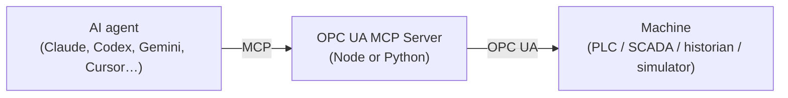
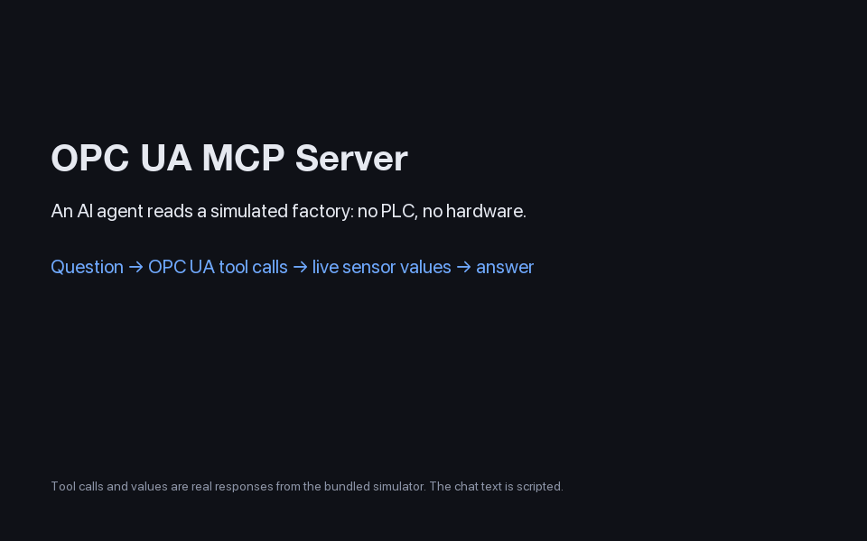

<div align="center">

# 🏭 OPC UA MCP Server

**Connect Claude, Codex, Gemini and any other MCP agent to machines over OPC UA.<br>
Read live data, watch for alarms and, only when you allow it, control equipment.**

[](https://www.npmjs.com/package/opcua-mcp-server)
[](https://pypi.org/project/opcua-mcp-server/)
[](https://www.npmjs.com/package/opcua-mcp-server)
[](https://github.com/IndustriAgents/OPCUA-MCP/actions/workflows/ci.yml)
[](https://modelcontextprotocol.io)
[](LICENSE)

[Watch the demo](#see-it-in-action) · [Quick start](#quick-start) · [Try it without hardware](#try-it-without-hardware) · [Connect your agent](#connect-your-agent) · [Tools](#tools) · [Safety](#safety-and-production) · [Docs](#documentation)

[Official MCP Registry](https://registry.modelcontextprotocol.io/?q=io.github.midhunxavier%2Fopcua) · [Glama](https://glama.ai/mcp/servers/IndustriAgents/OPCUA-MCP) · [HardwareMCP](https://hardwaremcp.khanex.ai/servers/industriagents-opcua-mcp/)

</div>

## See it in action

https://github.com/user-attachments/assets/2e1e9898-d942-41f6-bcc2-88e1a7ef1936

In this 3-minute demo, Claude watches a conveyor running in the free
[Prosys OPC UA Simulation Server](https://prosysopc.com/products/opc-ua-simulation-server/).
It reads the live values, checks the conveyor every minute on its own, reports
an overheat alarm with a suggested fix, and lowers the speed only after you
approve it. When asked for more than the allowed limit, it refuses. Codex
connects to the same server with one command.

## What it does

| | |
|---|---|
| 📖 **Read** | Browse the plant and read live values, history and events. Every value comes with its data type, quality, timestamps and unit ([example](docs/tools.md#what-comes-back)). |
| 👀 **Monitor** | Subscribe to values and events. The agent collects every change since it last looked. |
| 🚨 **Alarms** | List active alarms and, when you allow it, acknowledge them. |
| 🎛️ **Control** | Write setpoints and call methods, but only on targets you allowlist, within the limits you set, with every call written to an audit log. |

- **Any OPC UA server:** PLC, SCADA gateway, historian or simulator. Nothing to install on the plant side.
- **Any MCP agent:** Claude Code, Claude Desktop, Codex, Gemini CLI, Antigravity, Cursor, VS Code, Windsurf and more.
- **Node or Python:** two runtimes with the same tools. Use whichever you have.
- **Read-only by default:** control needs an explicit profile and a secured, verified connection.



Your agent starts the server as a local process (MCP over stdio). One process
talks to one OPC UA endpoint, so add one entry per server
([why](docs/configuration.md#one-process-one-endpoint)). Remote and shared
multi-client use is planned in the
[identity and isolation RFC](docs/rfc/0001-remote-identity-isolation.md).

## Quick start

**1. Check that it runs.** You need Node.js **22.13+** *or* Python **3.10+**
with [uv](https://docs.astral.sh/uv/getting-started/installation/). Pick one:

```bash
npx -y opcua-mcp-server --version   # Node
uvx opcua-mcp-server --version      # Python
```

It prints a version and exits. You don't start the server yourself after that:
your agent launches it. No Node or Python? Use the
[Claude Desktop bundle](#claude-desktop-bundle) or a
[single-file executable](docs/install.md#2-single-file-executable--no-runtime-at-all).

**2. Add it to your agent**, with your OPC UA server's endpoint. For Claude Code:

```bash
claude mcp add opcua -e OPCUA_SERVER_URL=opc.tcp://localhost:4840/freeopcua/server/ -- npx -y opcua-mcp-server
```

For Codex:

```bash
codex mcp add opcua --env OPCUA_SERVER_URL=opc.tcp://localhost:4840/freeopcua/server/ -- npx -y opcua-mcp-server
```

Replace the URL with your server's endpoint, and `npx -y opcua-mcp-server` with
`uvx opcua-mcp-server` for Python. Other agents: [Connect your agent](#connect-your-agent).
No OPC UA server yet? [Try it without hardware](#try-it-without-hardware).

**3. Ask.** Restart your agent or start a new session (approve the `opcua` server if it asks), then try:

- *"Check the OPC UA connection."*
- *"Browse the server and read the current values."*
- *"Watch the temperature for a minute and tell me what it does."*

A working connection reports `connected: true`. If it fails, check that the OPC
UA server is running and that `OPCUA_SERVER_URL` matches its endpoint, then see
[troubleshooting](docs/testing.md#troubleshooting).

## What you can ask

- *"What's the status of the line?"*
- *"What was the temperature over the last hour? Give me the hourly average."*
- *"What alarms are active right now?"*
- *"When did the motor temperature start rising? Check its history."*
- *"Set the valve position to 80%."* (needs the `operator` profile)

**Let the agent watch on its own.** The server keeps every change it sees, and
the agent reads them when it checks. To have it check on a schedule, use your
agent's scheduler. In Claude Code, for example:

```text
/loop 1m Watch Conveyor 1. If the overheat alarm turns on, tell me what happened and suggest a fix.
```

What works depends on the server: history needs historical access, server-side
averages need aggregates, and active alarms need Alarms & Conditions. Writes and
method calls need the `operator` profile, allowlisted targets and a secured
connection ([Safety](#safety-and-production)).

## Try it without hardware

**Prosys OPC UA Simulation Server.** A free desktop app for Windows, macOS and
Linux from [Prosys OPC](https://prosysopc.com/products/opc-ua-simulation-server/),
used in the demo above. Start it and copy the connection address from its
**Status** tab, for example `opc.tcp://localhost:53530/OPCUA/SimulationServer`.
Every scenario in our [compatibility tests](docs/compatibility.md) passed
against it on both runtimes.

**The simulated plant in this repository.** Needs Git, Python 3.10+ and uv,
even if you use the Node server:

```bash
git clone https://github.com/IndustriAgents/OPCUA-MCP.git
cd OPCUA-MCP
uv sync --all-packages
uv run --no-sync opcua-mock-server
```

Wait for `Server is running and ready for connections`, keep the terminal open,
and use `opc.tcp://localhost:4840/freeopcua/server/` as the endpoint.



<sub>Every tool call and value above is a real response from the bundled simulator,
recorded through the Python bridge under the read-only `observe` profile; the
question and answer text are scripted. Rebuild it with
[`scripts/readme_demo.py`](scripts/readme_demo.py).</sub>

<details>
<summary>What the simulated plant covers, and the extra mocks</summary>

The plant supports browsing, sensor reads, data-change subscriptions, raw value
history, plain events and event history. It also has writable actuators and
methods, subject to the server's control policy. It does **not** implement
processed aggregates or Alarms & Conditions. Use the separate mocks for those:

| Mock | Endpoint | Coverage |
|---|---|---|
| [Plant](packages/mock-server/README.md) | `opc.tcp://localhost:4840/freeopcua/server/` | Sensors, actuators, methods, raw history, subscriptions and plain events |
| [Aggregates](packages/mock-server-aggregate/README.md) | `opc.tcp://localhost:4841/UA/Aggregate` | Processed history, such as average buckets |
| [Alarms](packages/mock-server-alarms/README.md) | `opc.tcp://localhost:4842/UA/Alarms` | Active conditions and acknowledgement |

The separate mocks need Node and npm; their READMEs give the commands. If port
4840 is busy, start the plant with
`uv run --no-sync opcua-mock-server --endpoint opc.tcp://127.0.0.1:14840/freeopcua/server/`
and use that URL instead. The [MCP Inspector walkthrough](docs/testing.md) has
more examples.

</details>

## Connect your agent

Pick your agent below. The examples use the simulated plant's endpoint; replace
`opc.tcp://localhost:4840/freeopcua/server/` with yours. For Python, use
`"command": "uvx"` and `"args": ["opcua-mcp-server"]` in JSON, or
`command = "uvx"` and `args = ["opcua-mcp-server"]` in TOML. For a secure
connection, add the settings from [Safety](#safety-and-production) to the same
`env` block.

<a id="claude-desktop-bundle"></a>

<details>
<summary><b>Claude Desktop</b></summary>

**Easiest — the bundle.** Download `opcua-mcp-server-<version>.mcpb` from the
[latest release](https://github.com/IndustriAgents/OPCUA-MCP/releases/latest),
drag it into **Settings → Extensions**, and fill in **OPC UA endpoint**. No
Node, no Python, no JSON.


**Or let the server write the config** (needs Node or Python):

```bash
npm install -g opcua-mcp-server      # or: uv tool install opcua-mcp-server
opcua-mcp-server --install claude-desktop --url opc.tcp://localhost:4840/freeopcua/server/ --dry-run
```

It checks the config with the server's own startup validation and writes absolute
paths, because Claude Desktop does not inherit your shell's `PATH`. The profile
defaults to read-only; encryption, a pinned server certificate, a control profile,
a policy file and an audit file are all flags, and passwords are never taken as
flags. Check the preview, then repeat the command without `--dry-run` to write
the configuration and restart Claude Desktop. Every flag and safety rule, editing
`claude_desktop_config.json` by hand, and fixing a server that fails to start:
[docs/install.md](docs/install.md#3---install--let-the-server-write-the-config).

</details>

<details>
<summary><b>Claude Code</b></summary>

```bash
claude mcp add opcua -e OPCUA_SERVER_URL=opc.tcp://localhost:4840/freeopcua/server/ -- npx -y opcua-mcp-server
```

Add `--scope project` to share it with your team through `.mcp.json`.

</details>

<details>
<summary><b>OpenAI Codex</b></summary>

```bash
codex mcp add opcua --env OPCUA_SERVER_URL=opc.tcp://localhost:4840/freeopcua/server/ -- npx -y opcua-mcp-server
```

Or add it to `~/.codex/config.toml`:

```toml
[mcp_servers.opcua]
command = "npx"
args = ["-y", "opcua-mcp-server"]
env = { OPCUA_SERVER_URL = "opc.tcp://localhost:4840/freeopcua/server/" }
```

Or let the server write that entry, with the same checks as for Claude Desktop:
`opcua-mcp-server --install codex --url opc.tcp://localhost:4840/freeopcua/server/ --dry-run`.
This installer command requires a permanent package installation first:
`npm install -g opcua-mcp-server` or `uv tool install opcua-mcp-server`.
Check the preview and repeat without `--dry-run` to write it.

</details>

<details>
<summary><b>Gemini CLI</b></summary>

Add to `~/.gemini/settings.json`, or `.gemini/settings.json` in a project:

```json
{
  "mcpServers": {
    "opcua": {
      "command": "npx",
      "args": ["-y", "opcua-mcp-server"],
      "env": { "OPCUA_SERVER_URL": "opc.tcp://localhost:4840/freeopcua/server/" }
    }
  }
}
```

</details>

<details>
<summary><b>Google Antigravity</b></summary>

In the agent panel, open **⋯ → MCP Servers → Manage MCP Servers → View raw
config**, add the entry below to `mcp_config.json`, and restart Antigravity:

```json
{
  "mcpServers": {
    "opcua": {
      "command": "npx",
      "args": ["-y", "opcua-mcp-server"],
      "env": { "OPCUA_SERVER_URL": "opc.tcp://localhost:4840/freeopcua/server/" }
    }
  }
}
```

</details>

<details>
<summary><b>Cursor</b></summary>

Add to `~/.cursor/mcp.json`, or `.cursor/mcp.json` in a project:

```json
{
  "mcpServers": {
    "opcua": {
      "command": "npx",
      "args": ["-y", "opcua-mcp-server"],
      "env": { "OPCUA_SERVER_URL": "opc.tcp://localhost:4840/freeopcua/server/" }
    }
  }
}
```

</details>

<details>
<summary><b>VS Code (GitHub Copilot)</b></summary>

Add to `.vscode/mcp.json` — note the top-level key is `servers`:

```json
{
  "servers": {
    "opcua": {
      "type": "stdio",
      "command": "npx",
      "args": ["-y", "opcua-mcp-server"],
      "env": { "OPCUA_SERVER_URL": "opc.tcp://localhost:4840/freeopcua/server/" }
    }
  }
}
```

</details>

<details>
<summary><b>Windsurf</b></summary>

Add to `~/.codeium/windsurf/mcp_config.json`:

```json
{
  "mcpServers": {
    "opcua": {
      "command": "npx",
      "args": ["-y", "opcua-mcp-server"],
      "env": { "OPCUA_SERVER_URL": "opc.tcp://localhost:4840/freeopcua/server/" }
    }
  }
}
```

</details>

<details>
<summary><b>Any other MCP client</b></summary>

Most clients accept this `mcpServers` entry. The server speaks MCP over stdio.

```json
{
  "mcpServers": {
    "opcua": {
      "command": "npx",
      "args": ["-y", "opcua-mcp-server"],
      "env": { "OPCUA_SERVER_URL": "opc.tcp://localhost:4840/freeopcua/server/" }
    }
  }
}
```

</details>

> [!TIP]
> **No Node or Python on the machine?** Download a single-file executable from the
> [latest release](https://github.com/IndustriAgents/OPCUA-MCP/releases/latest)
> and use its path as the `command` — see [docs/install.md](docs/install.md).
> **Several PLCs?** Each entry talks to one endpoint, so add one entry per PLC
> ([why](docs/configuration.md#one-process-one-endpoint)).

## Tools

<!-- BEGIN GENERATED: tool-summary from contract/tools.json by packages/server-node/scripts/config-artifacts.mjs. Do not edit by hand: edit the source, then run `npm run config:generate` in packages/server-node. -->

**15 tools**, identical on both runtimes and defined once in [`contract/tools.json`](contract/tools.json). Arguments, results and limits: [docs/tools.md](docs/tools.md).

| Access | Offered under | Tools |
|---|---|---|
| **read** | every profile, including the default `observe` | `read_opcua_nodes` · `browse_opcua_nodes` · `read_opcua_history` † · `read_event_history` † · `get_server_status` · `list_subscriptions` · `list_active_alarms` |
| **monitor** | every profile, including the default `observe` | `subscribe_opcua_nodes` · `unsubscribe_opcua_nodes` · `subscribe_events` · `read_events` |
| **alarm-action** | `operator` with `OPCUA_ALLOW_ACKNOWLEDGE_ALARMS`, or `full` | `acknowledge_alarm` · `act_on_alarm` |
| **control** | `operator`, for allowlisted targets only, or `full` | `write_opcua_nodes` · `call_opcua_method` |

Control and alarm tools also need a verified server (a secured channel and a pinned `OPCUA_SERVER_CERT` or an `OPCUA_SERVER_TRUST_STORE`) unless a lab override is set. † Works only on a server that advertises the feature it needs, such as historical access.

<!-- END GENERATED: tool-summary -->

## Safety and production

> [!WARNING]
> By default the agent can only read, but the OPC UA connection is
> **unencrypted and anonymous**. That's fine for a simulator or a lab, not for
> real equipment. Secure the connection before connecting to anything that matters.

**1. Secure the connection and pin the server.** Add these to your agent's
`env` block, with paths to your own certificate files
([certificate guide](docs/certificates.md)):

```text
OPCUA_SECURITY_POLICY=Basic256Sha256     # implies SignAndEncrypt
OPCUA_CLIENT_CERT=/etc/opcua/client.pem  # this client's identity
OPCUA_CLIENT_KEY=/etc/opcua/client_key.pem
OPCUA_SERVER_CERT=/etc/opcua/server.pem  # pin the server you meant to reach
```

<details>
<summary>Logging in as a user, or trusting a CA instead of pinning</summary>

For a username and password, set both `OPCUA_USERNAME` and `OPCUA_PASSWORD`.
Supply the password through your client's secret storage or environment; the
installer never accepts it as a flag ([password handling](docs/install.md#passwords)).

For an X.509 user identity, leave the username and password unset and set both
`OPCUA_USER_CERT` and `OPCUA_USER_KEY`. These identify the user and are separate
from `OPCUA_CLIENT_CERT` and `OPCUA_CLIENT_KEY`, which secure the channel; X.509
user authentication needs a security policy other than `None`.

To trust a CA instead of pinning one certificate, set `OPCUA_SERVER_TRUST_STORE`
with `OPCUA_SERVER_APPLICATION_URI` ([certificate guide](docs/certificates.md)).

</details>

**2. Choose what the agent may do** with `OPCUA_PROFILE`:

| Profile | What the agent can do |
|---|---|
| `observe` *(default)* | Read, browse, history, subscriptions, events. No writes, no method calls. |
| `operator` | The above, plus **only** the nodes and methods you allowlist in `OPCUA_ALLOWED_WRITE_NODES` / `OPCUA_ALLOWED_METHODS`, optionally with value limits from a policy file. |
| `full` | Every tool. Only for a tightly scoped OPC UA account. |

**3. Keep a record.** Set `OPCUA_AUDIT_FILE` for an append-only log of every
control call: what was asked, whether it was allowed, and what happened.

A wrong setting stops the server at startup with a message naming the variable,
rather than failing later against live equipment. This policy adds to OPC UA's
own permissions; it doesn't replace them, so scope the OPC UA account to the
same nodes and methods. All settings, value limits and policy files:
[configuration](docs/configuration.md). Threat model: [SECURITY.md](SECURITY.md).

## Documentation

| Guide | What's inside |
|---|---|
| [Install](docs/install.md) | The `.mcpb` bundle, single-file executables, choosing a runtime, troubleshooting |
| [Configuration](docs/configuration.md) | Every setting, profiles, allowlists, value bounds, secure connections, reconnection |
| [Tools](docs/tools.md) | Full tool reference, result shapes, request limits, partial results |
| [Examples](docs/examples.md) | Every tool with real calls and responses against the mock plant |
| [Security](SECURITY.md) | What is and is not verified, the audit trail, reporting a vulnerability |
| [Certificates](docs/certificates.md) | Generating a client certificate a server will accept |
| [Compatibility](docs/compatibility.md) | Servers tested, and where the Python and Node runtimes differ |
| [Architecture](docs/architecture.md) | How it fits together, and why |
| [Testing](docs/testing.md) | The test suite, MCP Inspector and agent walkthroughs |
| [Roadmap](ROADMAP.md) · [Changelog](CHANGELOG.md) | What is next, and what has landed |

## Contributing

Contributions are welcome — see **[CONTRIBUTING.md](CONTRIBUTING.md)** for the
project layout, local development and adding a tool to both runtimes.

New here? The [good first issues](https://github.com/IndustriAgents/OPCUA-MCP/issues?q=is%3Aissue%20is%3Aopen%20label%3A%22good%20first%20issue%22)
are small and scoped to one pull request: a setup guide for another MCP client,
or a sample application built on the simulated plant. None needs OPC UA hardware.

The most useful thing you can send is a result from a real OPC UA server: open a
[compatibility report](https://github.com/IndustriAgents/OPCUA-MCP/issues/new?template=compatibility_report.md)
saying which server, which version and which tools worked. Test only on equipment
you are authorised to use, and keep writes and method calls to a simulator or lab.

## License

MIT — see [LICENSE](LICENSE).

Tool inputs and structured results use JSON Schema draft 2020-12 with generated
TypeScript/Python types and CI drift checks. See
[contract generation](docs/contract-generation.md) for the authoring workflow.
